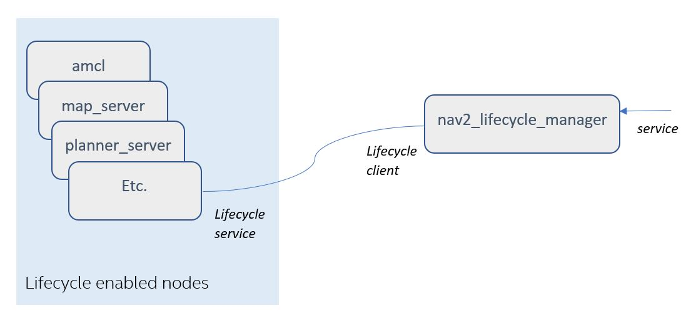
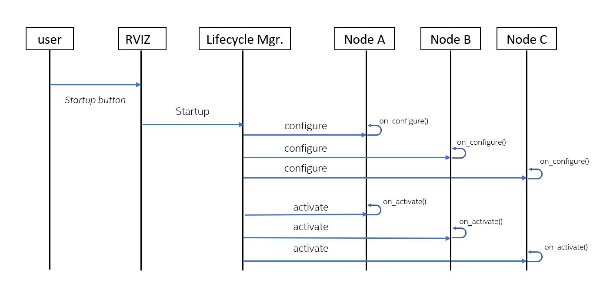

### Background on lifecycle enabled nodes
Using ROS2’s managed/lifecycle nodes feature allows the system startup to ensure that all required nodes have been instantiated correctly before they begin their execution. Using lifecycle nodes also allows nodes to be restarted or replaced on-line. More details about managed nodes can be found on [ROS2 Design website](https://design.ros2.org/articles/node_lifecycle.html). Several nodes in Nav2, such as map_server, planner_server, and controller_server, are lifecycle enabled. These nodes provide the required overrides of the lifecycle functions: ```on_configure()```, ```on_activate()```, ```on_deactivate()```, ```on_cleanup()```, ```on_shutdown()```, and ```on_error()```.

See its [Configuration Guide Page](https://docs.nav2.org/configuration/packages/configuring-lifecycle.html) for additional parameter descriptions.

### nav2_lifecycle_manager
Nav2's lifecycle manager is used to change the states of the lifecycle nodes in order to achieve a controlled _startup_, _shutdown_, _reset_, _pause_, or _resume_ of the navigation stack. The lifecycle manager presents a ```lifecycle_manager/manage_nodes``` service, from which clients can invoke the startup, shutdown, reset, pause, or resume functions. Based on this service request, the lifecycle manager calls the necessary lifecycle services in the lifecycle managed nodes. Currently, the RVIZ panel uses this ```lifecycle_manager/manage_nodes``` service when user presses the buttons on the RVIZ panel (e.g.,startup, reset, shutdown, etc.), but it is meant to be called on bringup through a production system application.

In order to start the navigation stack and be able to navigate, the necessary nodes must be configured and activated. Thus, for example when _startup_ is requested from the lifecycle manager's manage_nodes service, the lifecycle managers calls _configure()_ and _activate()_ on the lifecycle enabled nodes in the node list. These are all transitioned in ordered groups for bringup transitions, and reverse ordered groups for shutdown transitions.

The lifecycle manager has a default nodes list for all the nodes that it manages. This list can be changed using the lifecycle manager’s _“node_names”_ parameter.

The diagram below shows an _example_ of a list of managed nodes, and how it interfaces with the lifecycle manager.


The UML diagram below shows the sequence of service calls once the _startup_ is requested from the lifecycle manager.



---

## 中文翻译

### 生命周期节点的背景介绍

使用 ROS 2 的托管节点（Managed Node）/生命周期节点（Lifecycle Node）功能，可以让系统在开始运行之前，确保所有必需的节点都已经被正确创建。使用生命周期节点还可以实现在系统运行期间重启或替换节点。有关托管节点的更多信息，请参阅 [ROS 2 设计文档](https://design.ros.org/articles/node_lifecycle.html)。Nav2 中有多个节点支持生命周期管理，例如 `map_server`、`planner_server` 和 `controller_server`。这些节点按照要求重写了以下生命周期函数：`on_configure()`、`on_activate()`、`on_deactivate()`、`on_cleanup()`、`on_shutdown()` 和 `on_error()`。

有关其他参数的说明，请参阅对应的[配置指南页面](https://docs.nav2.org/configuration/packages/configuring-lifecycle.html)。

### nav2_lifecycle_manager

Nav2 的生命周期管理器用于改变各个生命周期节点的状态，从而对导航系统实现可控的启动（*startup*）、关闭（*shutdown*）、重置（*reset*）、暂停（*pause*）或恢复（*resume*）。生命周期管理器提供了 `lifecycle_manager/manage_nodes` 服务，客户端可以通过该服务请求执行启动、关闭、重置、暂停或恢复操作。生命周期管理器收到服务请求后，会调用各个受管理节点所需的生命周期服务。目前，当用户点击 RViz 面板上的按钮（例如启动、重置和关闭等）时，RViz 面板会调用 `lifecycle_manager/manage_nodes` 服务；在生产系统中，该服务通常应由负责启动系统的应用程序调用。

为了启动导航系统并使其能够执行导航，必须先配置并激活所需节点。例如，当客户端通过生命周期管理器的 `manage_nodes` 服务请求执行 *startup* 时，生命周期管理器会对节点列表中支持生命周期管理的节点调用 *configure()* 和 *activate()*。在系统启动的状态转换过程中，这些节点会按照配置的顺序分组进行转换；在系统关闭的状态转换过程中，则会按照相反的顺序进行转换。

生命周期管理器具有一个默认的受管理节点列表。可以使用生命周期管理器的 `node_names` 参数修改该列表。

下图展示了一个受管理节点列表的示例，以及这些节点与生命周期管理器之间的交互方式。


下面的 UML 图展示了向生命周期管理器发出 *startup* 请求后，各个服务的调用顺序。


